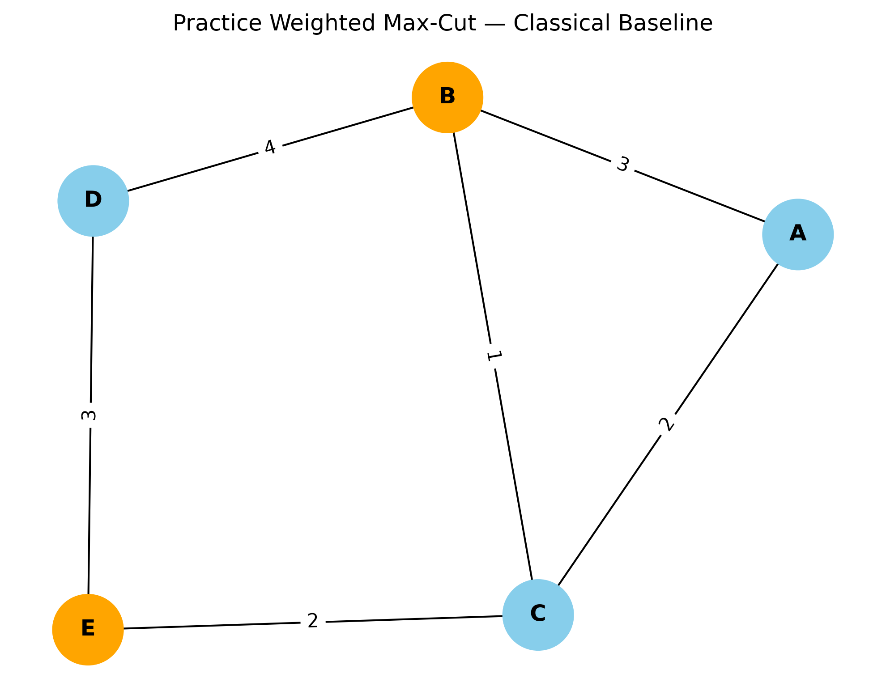

# ⚛️ NexGen Minds | QAOA Max-Cut Optimization

**Qiskit Fall Fest SRMAP 2026 — Quantum Optimization Practice Project**

Exploring the **Quantum Approximate Optimization Algorithm (QAOA)** to solve the weighted Max-Cut problem and investigate how quantum circuit connectivity affects circuit depth and gate overhead.

> **Project status:** Practice simulations only. The results below are not official hackathon processor benchmarks.

## 🎯 Project Objectives

* Solve a weighted Max-Cut problem using a classical baseline.
* Construct and simulate QAOA circuits.
* Explore QAOA parameter selection and validation.
* Compare circuit routing metrics for linear and ring connectivity.
* Analyze circuit depth, CX gates, total gates, and explicit SWAP gates.

## 🧩 Problem Graph

The practice graph contains five vertices and six weighted edges.

| Edge | Weight |
| ---- | -----: |
| A–B  |      3 |
| A–C  |      2 |
| B–C  |      1 |
| B–D  |      4 |
| C–E  |      2 |
| D–E  |      3 |

**Classical brute-force optimum: 13**

The optimum is the maximum total weight of edges crossing between the two vertex groups.

### Graph Visualization



## ⚙️ Workflow

1. **Classical baseline** — calculate the optimal cut using brute force.
2. **QAOA construction** — build a parameterized quantum circuit.
3. **Simulation and validation** — evaluate the circuit using Qiskit.
4. **Routing analysis** — transpile circuits for illustrative connectivity architectures.
5. **Metric comparison** — record depth, CX count, total gates, and explicit SWAP count.

## 📊 Practice Routing Results

| Metric              | Linear Connectivity | Ring Connectivity |
| ------------------- | ------------------: | ----------------: |
| Circuit depth       |                  79 |                65 |
| Total gates         |                 163 |               136 |
| CX gates            |                  21 |                18 |
| Explicit SWAP gates |                   0 |                 0 |

### Key Observation

Compared with the linear connectivity experiment, the ring experiment recorded:

* **17.72% lower circuit depth**
* **14.29% fewer CX gates**
* **16.56% fewer total gates**

These figures describe the recorded practice experiments only. They do not establish that ring connectivity will outperform a real processor under all workloads.

**Routing caveat:** The transpiler decomposes operations into the selected basis gates. Therefore, zero explicit SWAP gates in the final circuit does not mean routing added no overhead. CX count is used as a routing-cost proxy, not as an exact SWAP count.

## 📁 Project Structure

```text
maxcut-practice/
├── src/
│   ├── creating_comparison.py
│   ├── maxcut_classical.py
│   ├── maxcut_qaoa.py
│   ├── optimize_qaoa.py
│   ├── routing_analysis_v2.py
│   ├── routing_comparison.py
│   ├── swap_analysis.py
│   └── validate_qaoa.py
├── results/
│   ├── figures/
│   │   └── maxcut_graph.png
│   └── tables/
│       ├── routing_analysis_results.csv
│       └── swap_results.txt
├── requirements.txt
├── README.md
└── .gitignore
```

## 🚀 Getting Started

### Requirements

* Python version compatible with the installed Qiskit dependencies
* Qiskit
* Qiskit Aer
* NumPy
* Matplotlib
* NetworkX

### Installation

Clone the repository and enter the project directory:

```powershell
git clone https://github.com/reddynagendra273-All/qiskit-fall-fest-2026-o1-maxcut.git
cd qiskit-fall-fest-2026-o1-maxcut
```

Create and activate a virtual environment:

```powershell
python -m venv .venv
.\.venv\Scripts\Activate.ps1
```

Install dependencies:

```powershell
python -m pip install -r requirements.txt
```

### Run the Experiments

Run these commands from the project root:

```powershell
python src\maxcut_classical.py
python src\maxcut_qaoa.py
python src\optimize_qaoa.py
python src\validate_qaoa.py
python src\routing_analysis_v2.py
```

The scripts generate practice outputs and routing metrics according to their implementation.

## 🔬 Reproducibility and Limitations

* The graph and connectivity experiments are illustrative practice inputs.
* Results depend on circuit settings, transpiler configuration, seeds, and software versions.
* Routing comparisons are meaningful only when the circuits and experimental conditions are comparable.
* The unrestricted baseline is not a direct hardware-to-hardware comparison.
* No official hackathon processor execution or benchmark result is claimed.
* The official challenge kit, once available, must determine the final inputs, processor definitions, constraints, and evaluation metrics.

## 👥 Team

**NexGen Minds**

## 📌 Project Status

Quantum optimization practice project for preparation for **Qiskit Fall Fest SRMAP 2026 — PS-O1: Max-Cut on Weighted Graphs**.

The project will be updated with official challenge specifications and validated benchmark results when available.
